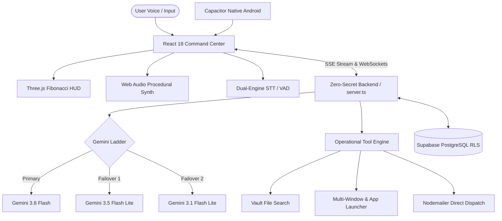

# JARVIS AI — Advanced Holographic Personal Intelligence Platform & Android Native Companion

[](package.json)
[](https://react.dev/)
[](https://www.typescriptlang.org/)
[](https://capacitorjs.com/)
[](https://ai.google.dev/)
[](releases/jarvis-v2.0.0.apk)
[](LICENSE)

An industrial-grade, Mark-85 inspired AI command center and native Android assistant. Combines real-time multimodal intelligence, procedural Web Audio acoustics, dual-engine speech recognition, Bixby-grade OS automation, custom voice macros, direct backend email dispatch, and an interactive 3D WebGL Fibonacci holographic core.

---

## 📱 Android APK Download & Installation

JARVIS includes a production-ready Android native build powered by **Capacitor 8**.

### Direct APK Download
- **Latest Debug APK:** [`releases/jarvis-v2.0.0.apk`](releases/jarvis-v2.0.0.apk)
- **Automated GitHub Releases:** Each commit or tag automatically builds fresh debug and release APKs via GitHub Actions.

### Android Installation Steps
1. Download `jarvis-v2.0.0.apk` onto your Android smartphone or tablet.
2. Tap the APK file to install.
3. If prompted by Android, enable **"Install unknown apps"** for your browser or file manager.
4. Launch **JARVIS AI** and grant Microphone permissions for the Acoustic Sensor Stream.

---

## 🚀 Key Feature Suite

```
  ┌────────────────────────────────────────────────────────────────────────┐
  │                           JARVIS CORE SUITE                            │
  ├────────────────────────────────────────────────────────────────────────┤
  │  [3D Fibonacci Core]    [Acoustic Sensor]       [Gemini 3.8 Ladder]   │
  │  Three.js WebGL Core    Dual-Engine STT + VAD   Multi-Model Failover  │
  ├────────────────────────────────────────────────────────────────────────┤
  │  [Bixby Intelligence]   [Routine Builder]       [Direct Gmail Dispatch]│
  │  OS Toggles & Files     Custom Voice Macros     Nodemailer Approval   │
  └────────────────────────────────────────────────────────────────────────┘
```

### 1. Resilient Multi-Model Gemini Ladder
- Primary orchestration powered by **Gemini 3.8 Flash** with automatic failover to `gemini-3.5-flash-lite` and `gemini-3.1-flash-lite`.
- Server-Sent Events (SSE) streaming with zero connection stalls or race conditions.
- Real-time tool execution via native Gemini `functionDeclarations`.

### 2. Dual-Engine Acoustic Sensor (Voice STT & VAD)
- **Engine A (Real-Time Web Speech API):** Low-latency speech recognition with interim and final transcript processing.
- **Engine B (Multimodal Gemini Audio Fallback):** Server-side audio transcription via `POST /api/voice/transcribe` with silence-detection Voice Activity Detection (VAD).
- **Decoupled Lifecycle:** Pinned callback refs prevent re-render teardown loops during continuous telemetry pushes.

### 3. Bixby-Grade Device Intelligence
- **Inline Notification Control:** Toggle notifications per application directly inside the holographic conversation stream.
- **Semantic Local File Finder:** Locates files, invoices, identity documents, and resumes with instant interactive preview cards.
- **Symptom-to-Setting Troubleshooter:** Diagnoses device pain-points (e.g., accidental pocket touches) and renders direct deep-link buttons to the exact system settings screen.
- **Chained Device Routines:** Multi-step macros (DND, Eye Comfort, brightness modulation, alarm scheduling).

### 4. Custom Routine & Macro Builder
- Dedicated **Routines** command tab to create, edit, and orchestrate custom automated macros.
- Matches spoken triggers (e.g. *"activate coding mode"*) against stored user routines in Supabase.
- Executes sequenced chains of application launches, URL browsing, volume adjustments, and system directives.

### 5. Direct Backend Gmail Dispatch
- Human-in-the-loop email drafting and approval cards.
- Dual-mode Nodemailer transporter supporting both **Gmail App Passwords** and **OAuth2 Refresh Tokens**.
- Sends high-fidelity HTML and plaintext emails directly from `server.ts` upon clicking **"Approve & Send Direct"**.

### 6. Holographic Mark 85 Command HUD
- **3D Fibonacci Sphere:** Interactive Three.js WebGL particle orb responding dynamically to AI states (`IDLE`, `LISTENING`, `PROCESSING`, `SPEAKING`).
- **Procedural Synthesizer:** Pure Web Audio API chirps, radar sweeps, alarms, and tactical telemetry tones with zero static audio files.
- **British Persona TTS:** Sentence-level streaming speech synthesis with instant user barge-in cancellation.

---

## 🏛️ System Architecture



---

## 🛠️ Tech Stack & Specifications

| Layer | Technologies |
| :--- | :--- |
| **Frontend Framework** | React 18, TypeScript 5.7, Vite 6, Tailwind CSS |
| **Graphics & HUD** | Three.js WebGL (Fibonacci Core), Framer Motion, Lucide Icons |
| **Mobile Runtime** | Capacitor 8.6, Android SDK, Gradle 8.14, OpenJDK 21 |
| **Backend & Routing** | Node.js, Express, tsx, ws (WebSockets), Server-Sent Events |
| **AI Orchestration** | Google Gemini API (3.8 Flash, 3.5 Flash Lite), Native Function Calling |
| **Email Subsystem** | Nodemailer (Gmail App Password & OAuth2) |
| **Database & RLS** | Supabase PostgreSQL with User-Isolated Row Level Security |

---

## 💻 Local Development Setup

### 1. Clone the Repository
```bash
git clone https://github.com/<your-username>/jarvis-ai.git
cd jarvis-ai
```

### 2. Install Dependencies
```bash
npm install
```

### 3. Configure Environment Variables
Copy `.env.example` to `.env` and provide your API keys:
```bash
cp .env.example .env
```

```env
# Gemini AI Engine
GEMINI_API_KEY=your_gemini_api_key_here

# Supabase Storage & Database
SUPABASE_URL=https://your-project.supabase.co
SUPABASE_SERVICE_ROLE_KEY=your_service_role_key_here
VITE_SUPABASE_URL=https://your-project.supabase.co
VITE_SUPABASE_ANON_KEY=your_anon_key_here

# Direct Backend Email Dispatch (Optional)
GMAIL_USER=your_email@gmail.com
GMAIL_APP_PASSWORD=your_16_char_app_password
```

### 4. Start Development Servers
Run backend engine and Vite console in parallel:
```bash
# Terminal 1: Backend Server (Port 3001)
npm run server

# Terminal 2: Frontend Command Center (Port 5173)
npm run dev
```

Open `http://localhost:5173` in your browser.

---

## 🤖 Compiling Android APK Locally

Ensure you have Java 17/21 and Android SDK installed on your workstation.

```bash
# 1. Build web application and sync native Android project
npm run cap:sync

# 2. Build Debug APK using Gradle
npm run build:apk

# 3. Or build directly via Gradle Wrapper
cd android
./gradlew assembleDebug
```

The compiled APK will be located at:
`android/app/build/outputs/apk/debug/app-debug.apk`

---

## 🛡️ Zero-Secret Security & RLS Enforcements

- **Client Bundle Isolation:** `GEMINI_API_KEY`, `SUPABASE_SERVICE_ROLE_KEY`, and `GMAIL_APP_PASSWORD` are restricted strictly to `server.ts`. Zero server credentials exist in `src/`.
- **Database RLS Policies:** All tables (`public.profiles`, `public.memories`, `public.action_queue`, `public.tasks`, `public.routines`, `public.conversations`, `public.messages`) strictly enforce user isolation (`auth.uid() = user_id`).
- **Android Sandboxing:** Android WebView requests are mediated with explicit permissions (`RECORD_AUDIO`, `INTERNET`, `ACCESS_NETWORK_STATE`).

---

## 📄 License
This project is licensed under the MIT License — see the [LICENSE](LICENSE) file for details.
